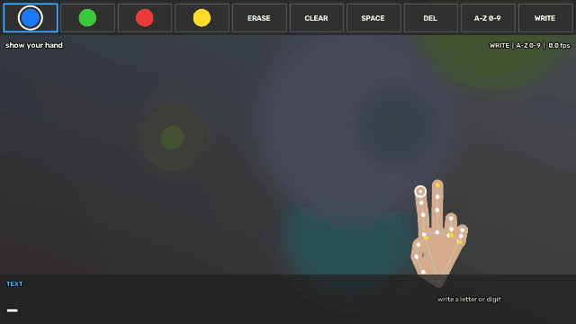
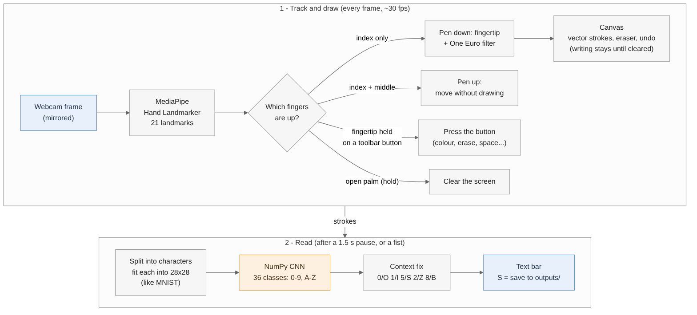
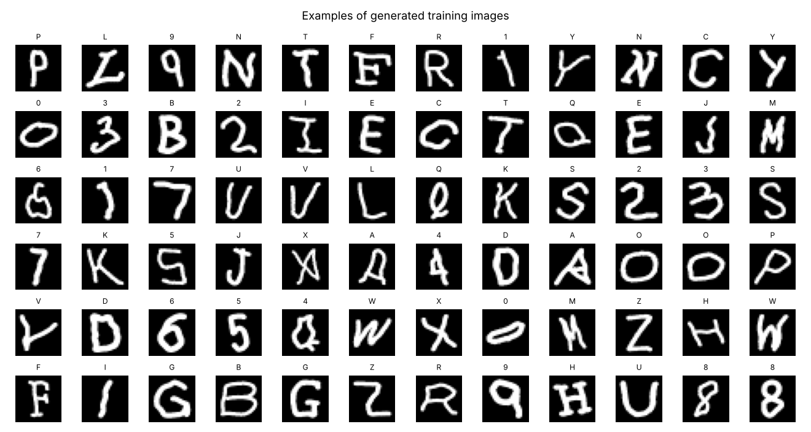
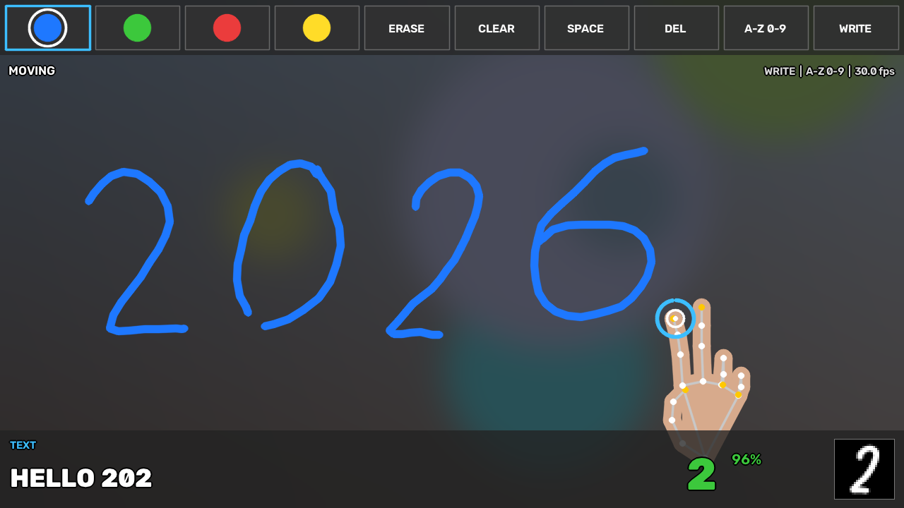
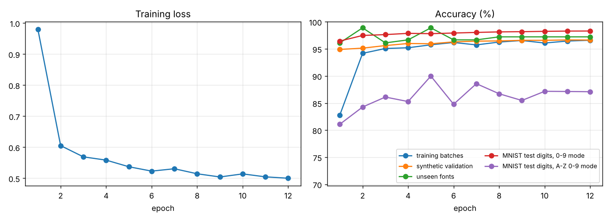

# Air Writing ✍️ — write in the air with your fingertip

Hold up your index finger in front of a webcam and write letters or digits in the air.
The app tracks your fingertip, draws your strokes on a virtual canvas, and a convolutional
neural network reads each character and types it into a text bar. It also works as a
free-hand **air canvas** for drawing in colour.



*(The demo is a simulated session made with `tools/simulate.py`; with a webcam you see yourself instead.)*

---

## Features

- **Real-time hand tracking** with MediaPipe Hand Landmarker (21 points per hand). Uses the
  MediaPipe *Tasks* API, so it works with current MediaPipe releases, which no longer include
  the old `mp.solutions.hands` API used by most tutorials.
- **Gesture control.** Draw, move, read a character, clear the canvas and press on-screen buttons
  using only your hand. No keyboard needed.
- **Your writing stays on screen** after it is read, until you wipe it away with an open palm.
- **Smooth strokes.** A One Euro filter removes fingertip jitter without adding lag. Tracking
  glitches and accidental flicks are filtered out.
- **Character recognition (0–9, A–Z)** with a CNN written from scratch in NumPy, so there is no
  TensorFlow or PyTorch to install. A trained model is included.
- **Several characters at once.** Write them side by side and they are split and read left to right.
- **Letters-only and digits-only modes**, plus a context fix for look-alikes (0/O, 1/I, 5/S, 2/Z, 8/B).
- **Draw mode**: 4 colours, eraser, undo, brush size, and camera/dim/blackboard/whiteboard backgrounds.
- **Save** the drawing, a screenshot and the text (`S`). The text is also saved automatically on exit.
- **Learns your handwriting.** Record your own samples (`--collect`) and fine-tune the model in about 5–10 minutes.
- **Tested.** 72 automated tests, including a simulated hand that writes through the full pipeline.

## How it works



1. **Track the hand.** Each webcam frame is mirrored and passed to MediaPipe, which returns
   21 landmarks for the hand.
2. **Read the gesture.** For each finger the app checks whether it is straight and pointing away
   from the wrist, using 3-D landmarks so it also works when you point at the camera. The
   combination of raised fingers gives the gesture. A gesture must hold for 3 frames before it
   counts, so strokes don't break from flicker.
3. **Draw.** While only the index finger is up, the smoothed fingertip position is added to
   the current stroke. Strokes are stored as vectors, which makes undo, the eraser and clean
   recognition possible.
4. **Read the character.** After a short pause (or a fist), the strokes written since the last
   character are grouped into characters by horizontal overlap. Each group is normalised like
   MNIST: fitted into a 20×20 box inside a 28×28 image and redrawn with a fixed stroke width, so
   it doesn't matter how big you write. The CNN then predicts one of 36 classes.
5. **Type it.** The character is added to the text bar and stays on screen as ink, until you
   clear it. When the network can't tell look-alikes apart, the previous character decides:
   "2O" becomes "20", and "L0" becomes "LO".

**The network** (`airwriting/cnn.py`): 3 × (3×3 convolution → ReLU → 2×2 max-pool) with
24/48/96 filters, then a 192-unit dense layer with dropout and a 36-way softmax. That is
225k parameters, trained with AdamW, label smoothing and a cosine learning-rate schedule.
Forward and backward passes are implemented with im2col + matrix multiplies and verified
against finite differences in the tests.

**The training data** (`airwriting/datagen.py`): the recogniser was trained on images built
to look like air-writing:

- hand-designed stroke templates for every character (81 writing variants), distorted with
  slant, wobble, tremor, jitter, uneven stroke placement, over/undershoot, little hooks and
  occasionally a pen that wasn't lifted between strokes;
- centre-lines of 39 font files (17 font families in regular, light and italic styles) plus
  OpenCV's 12 built-in Hershey font styles;
- 30,000 real handwritten digits from MNIST.

Every source is reduced to a thin centre-line and redrawn by the same renderer the live app uses,
so a font glyph, an MNIST digit and your fingertip path all look alike to the network.
A fresh randomly-distorted training set is drawn every 3 epochs.



## Setup

You need Python 3.10, 3.11 or 3.12 (64-bit) and a webcam. (The code and tests were last run
with Python 3.13, MediaPipe 0.10.32, OpenCV 5.0 and NumPy 2.5 on Linux; on Windows and macOS,
3.10–3.12 is the safest choice for MediaPipe.)

```bash
cd air-writing
python -m venv .venv
# Windows:          .venv\Scripts\activate
# macOS / Linux:    source .venv/bin/activate
pip install -r requirements.txt
python air_writing.py
```

On the first run the MediaPipe hand model (`hand_landmarker.task`, about 7.5 MB) is downloaded
into `models/`. After that, the app works offline.

## Using it

| Gesture | What it does |
|---|---|
| ☝️ **Index finger up** | Pen down: draw |
| ✌️ **Index + middle finger up** | Pen up: move without drawing |
| 👉 **Point at a toolbar button** (one or two fingers) and hold still ~½ s | Press it. A bar fills up under the button |
| ✊ **Fist** (hold briefly) | Read the character now |
| 🖐️ **Open palm** (hold ~1 s) | Clear the screen. Your writing stays until you do this |
| *pause ~1.5 s* | The character is read automatically (Write mode) |

Move around with **two fingers** so nothing is drawn. If you go to the toolbar with one finger,
the line you drew on the way up is removed when the button is pressed, and the pen stays up
until you show two fingers again (the status line tells you), so coming back down doesn't draw.



*Writing stays on screen after it is read: "2", "0" and "2" were read already, and the ring at
the fingertip fills up while the "6" waits to be read. The text bar shows "HELLO 202" so far and
the 28×28 image the network saw for the last "2".*

**Toolbar** (top of the screen): colours · ERASE · CLEAR · SPACE · DEL · charset (`A-Z 0-9` → `A-Z` → `0-9`) · mode (WRITE / DRAW).
ERASE turns your fingertip into an eraser: point with one finger to rub out ink. Press ERASE
again, or pick a colour, to go back to drawing.

**Text bar** (bottom): the text so far, the last character with its confidence and the runners-up,
and the 28×28 image the network actually saw.

| Key | Action | Key | Action |
|---|---|---|---|
| `Enter` | read now | `Space` / `Backspace` | add space / delete the last letter (or cancel the one you are writing) |
| `C` | clear canvas | `X` | clear text |
| `U` | undo last stroke | `M` | Write ↔ Draw mode |
| `K` | letters+digits / letters / digits | `1`–`4`, `E` | colour, eraser |
| `+` / `-` | brush size | `B` | background (camera, dim, blackboard, whiteboard) |
| `L` | show/hide hand skeleton | `S` | save picture + text to `outputs/` |
| `H` | help overlay | `Q` / `Esc` | quit |

### Tips for good recognition

- **Write big.** Aim for about a third to half of the screen height.
- **Lift the pen between strokes.** Show two fingers when moving to the start of the next stroke
  (for example from the legs of an **A** to its crossbar).
- Write one character, pause (or make a fist), then the next. To write several characters in
  one go, leave a clear gap between them.
- Switch to **`0-9`** or **`A-Z`** (key `K` or the toolbar) when you know which you need.
  This removes the 0/O and 1/I ambiguity completely.
- If letters get read before you finish them, give yourself more time with
  `python air_writing.py --delay 2.5`. You can still make a fist to read early.
- Good, even lighting and your hand 40–80 cm from the camera help the tracker.

### Command-line options

```text
python air_writing.py [--camera N] [--width 1280 --height 720] [--draw] [--delay 1.5]
                      [--auto-clear] [--background camera|dim|blackboard|whiteboard] [--video FILE]
                      [--record session.mp4] [--collect [CHARS]] [--per-char 5] [--no-mirror]
```

`--draw` starts in free-drawing mode, `--auto-clear` removes each character from the screen as
soon as it is read (instead of keeping it until you clear it), `--video` runs on a recorded video
instead of the webcam, and `--record` saves what you see to an MP4.

## Make it learn *your* handwriting

Everyone writes a little differently. Recording a few samples and fine-tuning gives a big boost:

```bash
python air_writing.py --collect              # prompts you for each character, 5 samples each
python air_writing.py --collect AEIOU --per-char 8   # or just the characters it gets wrong
python train_model.py --user-data user_data --init models/char_cnn.npz --epochs 3 --per-class 1500
```

While collecting, the text bar tells you which character to write. Each one is saved when you
pause (or make a fist). `DEL`/`Backspace` removes the last sample and `N` skips a character.

Samples are saved as stroke paths in `user_data/*.jsonl`. Fine-tuning mixes them, randomly
distorted, with freshly generated training data (stroke templates and your installed fonts), so
the model keeps what it already knew. If you have MNIST, add `--mnist path/to/mnist.npz` so the
digits stay as strong as they are. With the settings above it takes about 5–10 minutes.
The new model replaces `models/char_cnn.npz` (keep a copy if you want to go back), and
`python tools/evaluate.py` shows how it scores.

## Retrain from scratch (optional)

```bash
python train_model.py                                       # synthetic strokes + installed fonts
python train_model.py --mnist data/mnist.npz --emnist data/emnist   # + real handwriting
python train_model.py --model-size small --epochs 6         # faster on slow computers
```

The included model took about 30 minutes to train on a 2-core cloud machine (12 epochs of
144,000 images, with MNIST); most laptops are faster.

- **MNIST** (digits): a Keras-style `mnist.npz` or a folder with the four `*-ubyte.gz` files.
- **EMNIST letters**: a folder with `emnist-letters-train-images-idx3-ubyte.gz` and
  `emnist-letters-train-labels-idx1-ubyte.gz` (from NIST's EMNIST download). EMNIST mixes upper-
  and lower-case shapes under one label, so lower-case letters will also be read as capitals.

Training writes `models/char_cnn.npz`, a JSON report next to it, and plots in `docs/`
(training curves, confusion matrix, sample images).

## Accuracy

The included model, tested on characters it never saw during training:

| Test | Exact | Look-alikes OK¹ | Characters |
|---|---|---|---|
| Simulated hand writing in the air, through the whole app, mode `A-Z 0-9` | 99.4% | 100% | 180 |
| Same, in the `0-9` and `A-Z` modes | 98.9% | 98.9% | 180 |
| Randomly distorted stroke templates, straight into the model | 96.7% | 99.3% | 810 |
| Real handwritten digits (MNIST test set), mode `A-Z 0-9` | 87.1% | 97.2% | 10,000 |
| Real handwritten digits (MNIST test set), mode `0-9` | 98.3% | 98.3% | 10,000 |
| 5 fonts kept out of training (Poppins, Lora, Caladea, TeX Gyre Adventor and Bonum) | 97.2% | 100% | 180 |

¹ 0/O, 1/I, 5/S, 2/Z and 8/B have the same shape when written, so in the `A-Z 0-9` mode only
the neighbouring character can tell them apart. The `0-9` and `A-Z` modes avoid the problem.
Nearly all remaining mistakes are these pairs (see the [confusion matrix](docs/confusion_matrix.png)).

Run `python tools/evaluate.py` to repeat the first three tests (add `--mnist path/to/mnist.npz`
for the MNIST rows), for example after fine-tuning on your own handwriting.



Honest caveat: these tests use a simulated hand, pen-on-paper digits and fonts, not real people
writing in front of a webcam, and real air-writing varies more. The digits were learned
partly from real handwriting (MNIST); the letters only from synthetic strokes and fonts,
because no letter dataset was available when this model was trained. If some letters are
misread for you, the collect-and-fine-tune step above is the fastest fix. Training with EMNIST
letters also helps.

## Project structure

```text
air-writing/
├── air_writing.py          # run the app (webcam / video, window, keyboard)
├── train_model.py          # train or fine-tune the character model
├── requirements.txt
├── airwriting/
│   ├── app.py              # application logic: gestures -> drawing -> recognition -> text
│   ├── hand_tracker.py     # MediaPipe Hand Landmarker wrapper + model download
│   ├── gestures.py         # finger states, gesture classification, debouncing
│   ├── filters.py          # One Euro filter for the fingertip
│   ├── canvas.py           # vector strokes, eraser, undo, blending over video
│   ├── preprocess.py       # strokes -> 28x28 image, character splitting
│   ├── recognizer.py       # runs the CNN, charset limits, context fix
│   ├── cnn.py              # the NumPy convolutional network (train + inference)
│   ├── datagen.py          # training data: templates, fonts, MNIST/EMNIST, augmentation
│   ├── templates.py        # stroke templates for 0-9 and A-Z
│   ├── ui.py               # toolbar, text bar, cursor, help overlay
│   └── config.py           # all settings in one place
├── models/
│   ├── char_cnn.npz        # trained recogniser (included)
│   ├── char_cnn_report.json  # how it was trained and how well it scored
│   └── hand_landmarker.task  # downloaded on first run
├── tools/
│   ├── simulate.py         # simulated hand: demo GIF/video + end-to-end tests
│   └── evaluate.py         # accuracy check without a webcam
├── tests/                  # pytest suite
└── docs/                   # demo, screenshot, pipeline diagram, training plots
```

All tunable values (gesture timings, filter strength, brush size, recognition delay...) are in
`airwriting/config.py`.

## Running the tests

```bash
pip install pytest
python -m pytest tests
```

The tests check the CNN's gradients against finite differences, the gestures on rotated and
scaled hands, the canvas, the training script, and the full app with a simulated hand
writing in the air.

## Troubleshooting

| Problem | Fix |
|---|---|
| *Could not open camera* | Try `--camera 1`. Close Zoom/Teams/browser tabs using the camera. On macOS, allow camera access for your terminal or IDE in System Settings → Privacy & Security → Camera. |
| *Could not download the hand model* | Download [hand_landmarker.task](https://storage.googleapis.com/mediapipe-models/hand_landmarker/hand_landmarker/float16/latest/hand_landmarker.task) in a browser and save it as `models/hand_landmarker.task`. |
| `pip install mediapipe` fails | Use 64-bit Python 3.10–3.12. MediaPipe has no wheels for some Python versions. |
| `cv2` errors after installing | Two OpenCV packages are fighting. Run `pip uninstall -y opencv-python opencv-python-headless opencv-contrib-python`, then `pip install -r requirements.txt`. |
| Low frame rate | Run `python air_writing.py --width 960 --height 540`, and close other heavy apps. |
| Toolbar buttons don't react | Raise your hand until the fingertip is inside a button, then hold it still until the bar under the button fills (about half a second). The status line says HOLD STILL TO PRESS while you are on a button. Keep the whole hand in view. |
| Nothing is drawn after using the toolbar | The pen stays up after pressing a button with one finger. Show two fingers once (the status line says PEN UP), then draw with one finger. |
| Strokes break while writing | Improve the lighting and keep the whole hand in view. Keep the other fingers clearly folded while drawing. |
| Characters misread | Write bigger, lift the pen (two fingers) between strokes, use the `A-Z` / `0-9` modes, or fine-tune with `--collect`. |

## Ideas for extending it

- lower-case letters and punctuation (add templates/classes and retrain);
- word suggestions or a spelling corrector on the recognised text;
- text-to-speech for the written text (e.g. with `pyttsx3`);
- two-hand control (one hand writes, the other picks tools).

## Credits

- [MediaPipe](https://developers.google.com/mediapipe) Hand Landmarker by Google (Apache 2.0).
- MNIST handwritten digits by Y. LeCun, C. Cortes and C. Burges.
- G. Casiez, N. Roussel and D. Vogel, *1€ Filter: A Simple Speed-based Low-pass Filter for
  Noisy Input in Interactive Systems*, CHI 2012.
# Air-Writing

